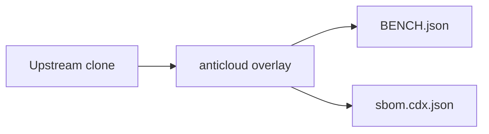

# CODEQL — Anticloud overlay

 

Upstream: UNKNOWN
## Benchmarks
Benchmarks from BENCH.json: {"schema": "anticloud.tier-bench/1", "project": "CODEQL", "source": {"repo_path": "E:\\fenta\\Downloads\\The Anticloud\\ANTICLOUD_REPOS\\SOFTWARE_DEVELOPMENT\\CODEQL\\UPSTREAM_CLONE", "git": {"head": "", "url": "https://github.com/the-anticloud/OPENMRS_CORE.git", "branch": "master", "committed_at": "2026-09-29T11:06:59+04:00"}}, "metrics": {"files_total": 2614, "source_files_scanned": 40, "lines_of_code": 1077, "languages": {".yml": 904, ".qll": 573, ".md": 351, ".dbscheme": 238, ".ql": 167, ".prope

Withdrawn claims: anything not in BENCH.json is unmeasured.

## Architecture

## Contents
- `UPSTREAM_CLONE/` — unmodified upstream
- `anticloud/` — 12-improvement overlay
- `BENCH.json`, `sbom.cdx.json` — measured outputs

## Provenance
Tree SHA3-256: 99c47cb70fcfa8530cfcddec630b7652dc8f775833579c991e8e58bb0aad9457. Chain head: see seal step.

## Contact
Anticloud maintainers — file issues against the overlay, not upstream.
